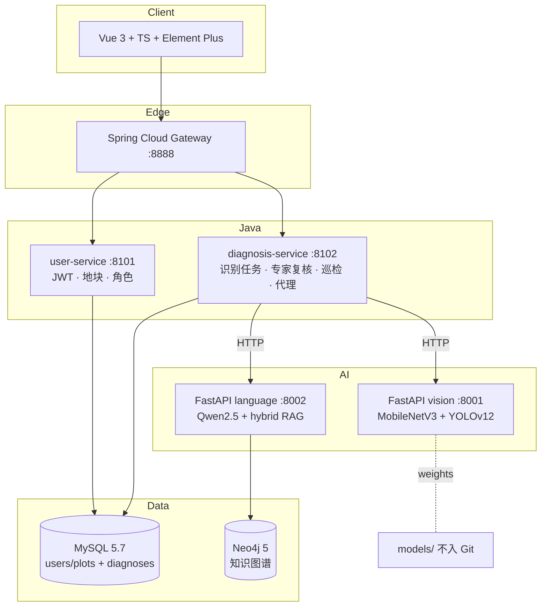

# 寰航智农 · Huanhang Smart Agriculture

> **项目展示仓（Showcase）**  
> This repository is a project showcase. The complete source code is maintained in a **private** repository: [`huanhang-smart-agriculture-core`](https://github.com/lsfjames/huanhang-smart-agriculture-core).

本地优先的智慧农业 AI 平台：**叶片病害分类 · 病斑检测 · 知识图谱问答 · 微服务业务闭环**。

面向岗位：AI 应用工程师 / FDE · AI 解决方案 / AI 算法工程师。

[English README](README_EN.md) · [架构](docs/ARCHITECTURE.md) · [技术栈](docs/STACK.md) · [实验指标](docs/METRICS.md) · [演示脚本](docs/DEMO_SCRIPT.md)

---

## 一分钟了解

| 维度 | 内容 |
| --- | --- |
| 问题 | 农户拍叶难判断病害；客服/专家成本高；答案易“编造” |
| 做法 | 分类 + 检测 + **可溯源 RAG 问答**；角色业务（农户/专家/管理） |
| 形态 | Vue3 前端 · Spring Cloud · FastAPI(AI) · MySQL · Neo4j · Docker Compose |
| 诚实边界 | 检测 mAP 基线偏低、Docker/CI **未在本机完成实测**（见文末限制） |

```text
上传叶片 ──► MobileNetV3 三分类 ──► 诊断入库
          └─► YOLOv12n 病斑框 ──► 叠加展示（标签空间隔离）
专家复核 ◄── 待复核队列（跨农户）     管理端：用户/模型版本/知识审核
问答 ──► Neo4j 图谱 + hybrid RAG ──► 引用核验 / 资料不足拒答
巡检 ──► Offline Replay（历史图回放，非无人机）
```

---

## 目录

1. [背景与价值](#1-背景与价值)
2. [系统架构](#2-系统架构)
3. [技术栈](#3-技术栈)
4. [业务功能](#4-业务功能农户--专家--管理员)
5. [AI 能力与真实指标](#5-ai-能力与真实指标)
6. [工程与测试](#6-工程与测试)
7. [部署与验证状态](#7-部署与验证状态)
8. [关键技术难点](#8-关键技术难点)
9. [演示](#9-演示)
10. [Roadmap](#10-roadmap)
11. [限制与许可](#11-限制与许可)

---

## 1. 背景与价值

- **识别**：田间叶片症状与混淆病（早疫/晚疫/Septoria 等）肉眼难分 → 给出分类与病斑框作参考（非正式诊断）
- **可信问答**：通用大模型易给出剂量/预测等危险建议 → **知识卡 + 来源审核 + 引用核验 + 拒答**
- **协作**：农户上传、专家复核、管理员治理，而非单一 Demo API
- **工程**：从原型到微服务、异步任务、权限、测试与发布审计的完整链路

---

## 2. 系统架构



模块职责详见 [docs/ARCHITECTURE.md](docs/ARCHITECTURE.md)。

---

## 3. 技术栈

| 层 | 选型 | 职责 |
| --- | --- | --- |
| **前端** | Vue 3 · TypeScript · Vite · Element Plus | 登录/地块/诊断/历史/问答/图谱/专家台/管理台/巡检回放 |
| **后端** | Spring Boot 3.4 · Spring Cloud Gateway · JWT · Flyway | 账号权限、诊断业务、跨服务调用、审计字段 |
| **AI 推理** | FastAPI · PyTorch | 分类/检测/语言独立生命周期与超时 |
| **分类** | MobileNetV3-Small（迁移学习） | 番茄叶三分（早疫/晚疫/健康） |
| **检测** | YOLOv12n（官方实现，AGPL） | PlantDoc 29 类病斑/叶部框 |
| **语言** | Qwen2.5-0.5B-Instruct | 本地生成，审核卡约束 |
| **检索** | keyword / graph / hybrid + Neo4j Cypher | 证据卡与图路径 |
| **数据** | MySQL 5.7 · Neo4j 5.26 | 业务库 + 知识图谱 |
| **工程** | JUnit · unittest · Docker Compose · GitHub Actions | 测试与交付（Docker/CI 见验证状态） |

**不堆砌未使用框架**；服务发现/配置中心等有意保持简单。

---

## 4. 业务功能（农户 / 专家 / 管理员）

| 角色 | 能力 |
| --- | --- |
| **农户** | 注册登录、地块、上传叶片→分类+检测、历史、问答、发起巡检回放任务 |
| **专家** | 跨农户**待复核队列**、诊断详情、CONFIRM/OVERRIDE/UNCERTAIN 与意见、历史复核 |
| **管理员** | 用户角色管理、**模型版本清单**（sha256/run_id）、**知识卡审核台**、全链路状态 |

权限：FARMER 无队列/模型清单（403）；跨用户诊断 404；复核写接口 EXPERT/ADMIN。

---

## 5. AI 能力与真实指标

> 以下均为**验证集/离线实验**，**不是**田间部署效果。

| 模型 | 任务 | 真实指标 | 说明 |
| --- | --- | --- | --- |
| **MobileNetV3-Small** | 番茄叶 3 分类 | **Accuracy ≈ 0.935 · Macro-F1 ≈ 0.934** | 固定 checkpoint 验证；softmax **未校准** |
| **YOLOv12n** | PlantDoc 29 类检测 | **mAP@50 = 0.074 · mAP@50-95 = 0.045 · P/R = 0.40/0.15** | ~11 epoch 后 **4GB GPU OOM 中断**；基线可演示，**非高精度** |
| **Qwen + RAG** | 限定知识问答 | hybrid 检索命中率 **0.9286**（dev 28 题） | 资料不足**拒答**；引用 ⊆ 上下文 |
| **图谱** | 可溯源事实 | 71 节点 / 118 边 | 卡片+来源+审核记录 |

完整实验记录见 [docs/METRICS.md](docs/METRICS.md)。

---

## 6. 工程与测试

| 套件 | 结果 |
| --- | --- |
| JUnit（真 MySQL + Flyway） | **26 / 26** |
| 知识审核并发/原子写 | **6 / 6** |
| 系统审查探针（联调+权限+AI） | **17 / 17** |
| 网关 E2E（阶段 9） | **11 / 11** |
| 故障注入（超时/越权/坏上传） | **9 / 9** |

要点：缺 multipart → 400；非法 retriever → 422；Neo4j 宕机 hybrid 降级并告警。

---

## 7. 部署与验证状态

| 方式 | 状态 |
| --- | --- |
| **Windows 原生进程** | **已验证**（MySQL/Neo4j/FastAPI/Spring/Vue 全栈业务闭环） |
| **Docker Compose** | **未验证**（本机未安装 Docker；配置已备，见私有仓 `DOCKER_INSTALL_PLAN.md`） |
| **GitHub Actions** | **工作流已编写，未在远程跑通前不宣称 CI 通过** |

本地运行与 Compose 设计说明：私有工程仓 `docs/` 与 `docker-compose.yml`。

---

## 8. 关键技术难点

1. **可信 RAG**：审核状态门禁 + 来源已核实 + 答案引用核验 + 超范围拒答，降低“编造农技建议”风险  
2. **检测/分类标签隔离**：PlantDoc 框类 ≠ 番茄三分病名，UI 并列展示、禁止伪造成框  
3. **4GB 显存约束**：YOLOv12n + AMP；OOM 后可续训；指标如实披露  
4. **微服务边界**：Gateway + user/diagnosis；AI 独立 FastAPI；跨库所有权清晰  
5. **离线巡检**：明确 **Offline Replay**，不冒充无人机实时链路  

---

## 9. 演示

- **脚本（3–5 分钟）**：[docs/DEMO_SCRIPT.md](docs/DEMO_SCRIPT.md)  
- **截图**：[docs/screenshots/](docs/screenshots/)  
- 视频可按脚本录制；未包含真实客户数据。

---

## 10. Roadmap

| 版本 | 目标 |
| --- | --- |
| v1.1 | Docker Compose 与 CI 在干净环境实测；检测续训提升 mAP |
| v1.2 | 知识审核入库与多副本；模型灰度切换 UI |
| v2.0 | 真实田间数据闭环（替换 Offline Replay）与移动端 |

---

## 11. 限制与许可

**限制（请勿当作成熟植保产品）**

- 非医疗器械/非正式植保结论；分类分数未校准  
- 检测 mAP 低；训练中断  
- Docker / CI 本机**未完成实测**  
- 知识域以番茄相关公开推广资料为主  

**许可**

- 本展示文档与首方说明：MIT（见 [LICENSE](LICENSE)）  
- 完整工程源码在私有仓；其中含 **YOLOv12/Ultralytics AGPL-3.0**、**PlantDoc CC-BY-4.0**、Qwen 等第三方条款（见 [docs/LICENSES.md](docs/LICENSES.md)）  
- **请勿**将本展示仓误认为完整 AGPL 源码镜像  

---

© 2026 寰航智农 Project Showcase · Maintainer: [lsfjames](https://github.com/lsfjames)
