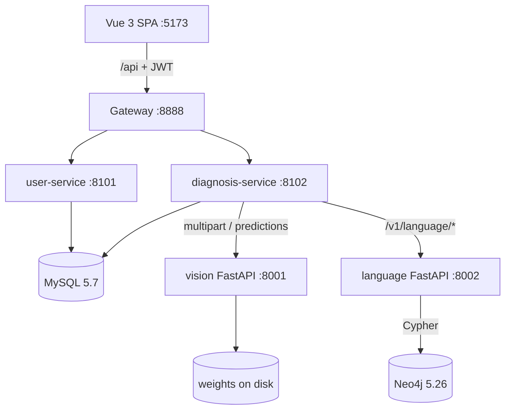

# 系统架构 / System Architecture

## 分层图

## 模块职责

| 模块 | 职责 | 不负责 |
| --- | --- | --- |
| Gateway | 路由、X-Request-ID、聚合文档入口 | 业务逻辑 |
| user-service | 注册登录 JWT、角色、地块、概览聚合 | 诊断写库 |
| diagnosis-service | 识别任务、专家复核、巡检、模型清单、AI 代理 | 用户口令 |
| vision FastAPI | MobileNet 分类、YOLO 检测、上传校验 | 业务库 |
| language FastAPI | Qwen 生成、检索、知识卡 API、图查询 | 训练 |
| MySQL | users/plots + diagnoses/tasks/reviews/inspection | 文件权重 |
| Neo4j | 作物/病害/症状/措施/来源/审核图 | 用户业务 |

## 跨服务调用

- 诊断 → 用户：`GET /api/plots/{id}`（转发 Bearer，边界 404/502）
- 用户 → 诊断：`GET /api/diagnosis/stats`
- 诊断 → FastAPI：vision multipart；language JSON
- 失败：稳定 4xx/5xx 信封 + request_id；不假装成功

## 数据边界

- **双业务库**：`huanhang_users`（users, plots）、`huanhang_diagnosis`（diagnoses, recognition_tasks, expert_reviews, inspection_*）
- Flyway V1/V2 迁移；测试库隔离 `*_test`
- 权重/原始数据不入 Git
